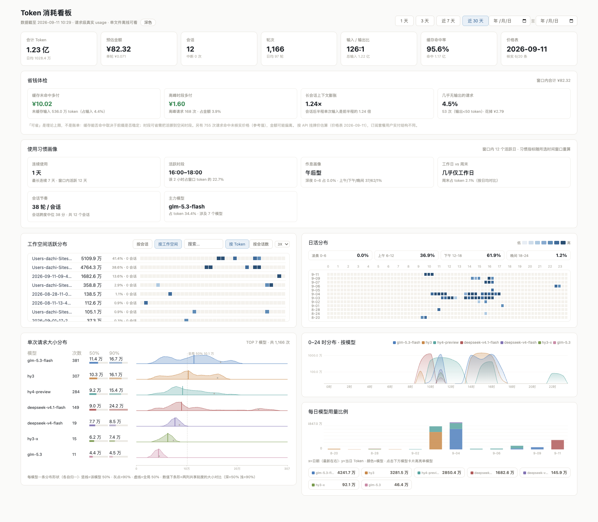

# token-dashboard

把 WorkBuddy 的真实 token 消耗变成一张**单文件离线看板**。作为一个 WorkBuddy Skill 分发：别人加载后说一句"看看我的 token 用量"，Agent 就会扫描本机会话日志，生成同款看板并打开。



## 功能

- **KPI**：合计 Token / 日均 / 会话 / 轮次 / 输入输出比 / 缓存命中率 / 预估金额（元）/ 价格表核实状态
- **省钱体检**：缓存未命中多付、高峰时段多付、长会话上下文膨胀、几乎无输出的请求——给「理论上限」而非账单
- **使用习惯画像**：连续使用天数、活跃时段、作息类型（深夜党/上午型/午后型/晚间型）、工作日 vs 周末、会话节奏中位数、主力模型浓度
- **日活热力图**：20 分钟粒度，色阶对数插值，悬停看明细
- **0–24 时模型山脊图**：各模型按时段的消耗分布（对数轴），可点击高亮
- **每日模型用量比例**：堆叠柱 + 模型卡片，点击高亮单模型
- **单次请求大小分布**：每模型 50% / 90% 分位与分布形状
- **三级下钻**：工作空间 → 会话 → 单次请求（散点 + 逐条明细表）
- 深浅色主题（记忆偏好）、1 / 3 / 7 / 30 天窗口 + 自定义日期区间
- 数据为**请求级真实 usage**（非估算），输出单文件 HTML，离线可看、无外部依赖

## 安装（作为 Skill）

把本仓库内容放到 WorkBuddy 用户级技能目录：

```
~/.workbuddy/skills/token-dashboard/
├── SKILL.md
├── prices.json
└── scripts/
    ├── gen_dashboard.py
    ├── template.html
    └── verify.py
```

- Windows：`C:\Users\<你>\.workbuddy\skills\token-dashboard\`
- macOS / Linux：`~/.workbuddy/skills/token-dashboard/`

```bash
git clone https://github.com/dazhi-G/token-dashboard.git ~/.workbuddy/skills/token-dashboard
```

重启 WorkBuddy 会话即可加载。之后直接说"看看我的 token 用量"即可触发。

## 手动运行（不装 Skill 也行）

Python 3.8+，仅标准库，无需装任何包：

```bash
python scripts/gen_dashboard.py                  # 输出 ./token-dashboard.html
python scripts/gen_dashboard.py --out 看板.html   # 自定义输出路径
```

- Windows（Git Bash / CMD / PowerShell 均可）
- macOS / Linux 同上

## 数据说明

- 数据源：`~/.workbuddy/projects/**/*.jsonl` 中每条记录的 `providerData.rawUsage / usage` 字段（请求级真实 usage）；子代理日志自动归属父会话。
- 缓存字段兼容三套流派：DeepSeek（`prompt_cache_hit_tokens` / `prompt_cache_write_tokens`）、OpenAI（`prompt_tokens_details.cached_tokens`）、Anthropic（`cache_read_input_tokens` / `cache_creation_input_tokens`）。Anthropic 的 `input_tokens` 与缓存读写是并列关系，另两家把缓存命中包含在 `prompt_tokens` 里，脚本按「base_in < 缓存读+写」自适应判断。
- 计价读根目录的 `prices.json`（元 / 百万 token），规则：最长前缀匹配（不依赖 key 顺序）、`from` 控制按日期生效（按本地时区解释）、`peak` 控制峰谷分时（如 DeepSeek 高峰 9–12 / 14–18，空闲价为高峰价一半）。价格表缺失或损坏时回退内置兜底值并在页面标注，不中断生成。
- 金额按 API 挂牌价估算，订阅套餐用户实付结构不同，仅供参考。
- 所有数据均来自本机日志，不外发、不上传。

## 价格表维护

价格表会过期，厂商调价时改 `prices.json`：给新条目加 `from` 生效时间，**不要删旧条目**——历史请求要按当时价格计价。核实过的条目置 `verified: true`，页面 KPI 会显示「核实 N/M 条」。

## 自检

改动模板或价格表后跑一次端到端校验（需要 Node.js，仅测试用；看板本身零依赖）：

```bash
python scripts/verify.py --build
```

校验内容：JS 语法、价格引擎断言（前缀匹配 / 按日期生效 / 峰谷分时 / 成本计算）、多窗口与下钻的渲染健壮性冒烟测试。

## 目录结构

```
token-dashboard/
├── SKILL.md                  # Skill 定义（Agent 加载后按此执行）
├── README.md
├── prices.json               # 价格表（元 / 百万 token）
├── docs/
│   └── screenshot.png        # 看板截图
└── scripts/
    ├── gen_dashboard.py      # 看板生成脚本（跨平台，仅标准库）
    ├── template.html         # 页面结构与样式模板
    └── verify.py             # 端到端自检
```
